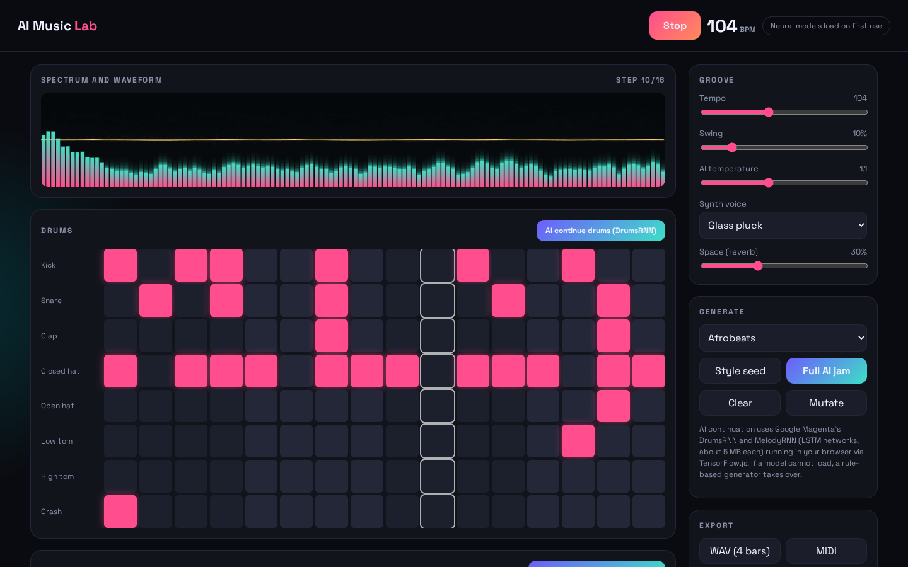

# AI Music Lab

A generative beat and melody composer: Magenta DrumsRNN and MelodyRNN improvise on your patterns, Tone.js plays them, with live visualizers and WAV and MIDI export.

**Live demo:** https://josephbepocode.github.io/ai-music-lab/



## Features

- **16 step drum machine** (8 synthesized voices) and a **pentatonic piano roll**.
- **AI continuation:** Google Magenta DrumsRNN completes the second half of your beat, MelodyRNN continues your opening motif. Temperature controls creativity.
- **Style seeds:** house, boom bap, Afrobeats, drum and bass, lo-fi, plus a "Full AI jam" that seeds a style then lets both networks take over.
- **Sound design:** four synth voices, swing, reverb, tempo 60 to 170 BPM.
- **Visualizer:** real-time FFT spectrum plus waveform, animated playhead.
- **Export:** offline-rendered WAV (Tone.Offline, 16-bit), standard MIDI file, and shareable URLs that encode the whole pattern.

## Tech

Tone.js 14.7, @magenta/music 1.23.1 (TensorFlow.js), Web Audio API. The two LSTM checkpoints (about 5 MB each) load on first use from Magenta's public bucket.

Fully static: no server, no API keys, no paid services. Hosted on GitHub Pages.

## Run locally

```bash
git clone https://github.com/josephbepocode/ai-music-lab.git
cd ai-music-lab
python3 -m http.server 8000
# open http://localhost:8000
```

## Notes and limitations

If a model checkpoint cannot be fetched, a rule-based generator is used instead and the status pill says so. Audio starts only after a click, as browsers require.

## License

MIT, built by Deji ([@josephbepocode](https://github.com/josephbepocode)).
